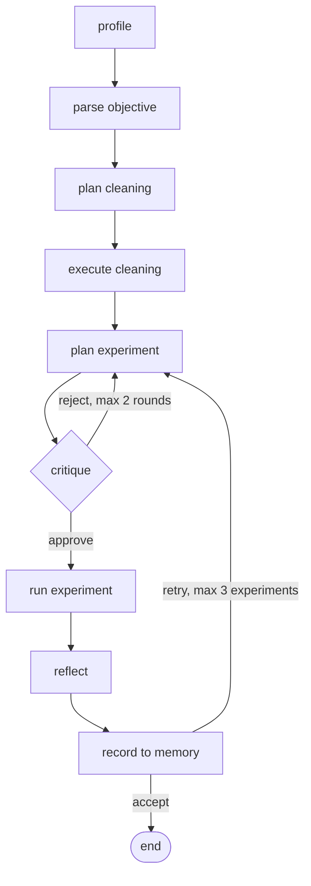

# AI Data Scientist Agent

An agentic system that takes a tabular CSV and a plain-English objective, then profiles the data, plans and executes cleaning, plans an experiment, has an independent critic review it, trains and evaluates a model, reflects on the result, and replans if the result isn't good enough. Every decision is recorded in a readable trace, and every result is stored in persistent memory so later runs on the same data can learn from earlier ones.

Scope: tabular data, classification and regression, scikit-learn models. Built with LangGraph, Pydantic, SQLite, FastAPI and the Gemini API.

## Demo

Request: upload `house_prices_train.csv` (Kaggle House Prices) with the objective *"predict house sale prices and minimize RMSE, with particular emphasis on avoiding large errors for expensive homes"*.

A successful API run produced:

```text
profile_node              1460 rows, 81 cols, flags=[]
parse_objective_node      target = SalePrice, task = regression, metric = rmse
cleaning_plan_node        9 cleaning actions proposed
execute_cleaning_node     cleaned_df shape=(1460, 75)
plan_experiment_node      GradientBoostingRegressor, 73 features, memory_entries=1, critique_feedback=no
critique_experiment_node  verdict=approve, concerns=0, round=1
run_experiment_node       rmse=26188.8230, baseline=87619.0345, beats_baseline=True
reflect_node              decision=accept, experiment_iteration=1
record_experiment_node    saved to memory (accepted=True)
```

The GradientBoostingRegressor achieved an RMSE of **26,188.82**, compared with a baseline RMSE of **87,619.03**, on 292 test rows.

A second identical request retrieved the previous experiment from memory (`memory_entries=2`) and selected a different model:

```text
plan_experiment_node      RandomForestRegressor, 73 features, memory_entries=2, critique_feedback=no
critique_experiment_node  verdict=approve, concerns=0, round=1
run_experiment_node       rmse=28830.2332, baseline=87619.0345, beats_baseline=True
reflect_node              decision=accept, experiment_iteration=1
record_experiment_node    saved to memory (accepted=True)
```

The second run achieved an RMSE of **28,830.23**. Both experiments beat the baseline and were saved as accepted experiments.

The agent also rejects an unsatisfiable request such as *"What is my favorite color?"* when the supplied dataset contains no relevant target. The API returned `accepted=false`, explained that the objective cannot be satisfied with the dataset, and stopped after objective parsing rather than inventing a target column.

The same agent, with no code changes, also handles the 3-column `Social_Network_Ads` classification dataset.

## How it works



If any node fails, the graph routes to the end with an `error_message` and the trace shows where it stopped. If the critique round cap is reached without approval, the plan is trained anyway (the critic is a bounded quality gate, not a veto).

### Deterministic code vs. LLM judgment

The rule throughout: code does anything mechanical or checkable, and the LLM is used only where interpretation is unavoidable.

| Deterministic code | LLM judgment |
|---|---|
| Profiling and data-quality flags | Interpreting the objective (target, task, metric) |
| Validating every LLM output against the real data | Choosing cleaning actions |
| Cleaning execution, preprocessing, training | Choosing a model, features and hyperparameters |
| Metrics, baseline, metric direction (higher or lower is better) | Reviewing a plan before it runs (critic) |
| Retry rule: not beating the baseline always forces a retry | Judging whether a result satisfies the objective |
| Memory storage and retrieval, routing, iteration caps | |

### Validation layers

Schema validity is never trusted on its own. LLM outputs are checked against the actual dataset:

- **Objective:** the target column must exist, the metric must be in a registry of supported metrics and must fit the task type, and the model may declare the objective unsatisfiable instead of forcing a fit.
- **Cleaning:** the column must exist, the action must suit its dtype, and imputing or dropping needs evidence in the profile (for example no imputing a column with 0% missing).
- **Experiment:** the model must come from an allow-list for the task type, features must exist, and the target must not be among them (leakage).

### Memory

Experiments are stored in SQLite, keyed by a hash of the dataset's content plus the target column and task type, so renaming a file or rephrasing the objective doesn't lose history. Before planning, the agent retrieves a bounded set of past experiments (best, most recent and rejected, deduplicated, capped at 8) and labels each as accepted or rejected in the planner's prompt. Ranking respects metric direction.

## Problems the checks caught during development

- **Silent substitution.** Asked to predict "favorite color" on a dataset with no such column, the parser quietly picked `Purchased` instead. Fixed with an explicit `is_satisfiable` field so the model can refuse honestly. The current validation returns `accepted=false` and stops after objective parsing for this case.
- **Hallucinated column.** The cleaning planner proposed an action on a column called `Dataset`, mistaking a prompt section label for a column. The existence check rejected it, and the prompt now separates the two lists explicitly.
- **A meaningless baseline.** The reflector justified accepting results by "beating the baseline", but for recall the dummy baseline scores 0 by construction. The prompt and the reflector's context now depend on the metric.
- **Metric direction.** `beats_baseline` assumed higher is better, which would have rejected every good RMSE result. Direction now lives in a metric registry used by the executor and by memory.
- **Plans that couldn't run.** The critic approved a plan using string columns that the executor didn't encode. The executor now imputes and one-hot encodes automatically, and the planner and critic are told so.
- **Stale schema.** The planner proposed a column the cleaning step had already dropped. The planner and critic now see only the columns that survived cleaning.
- **Reproducibility.** Model training sets `random_state=42` whenever the selected estimator supports it. Three consecutive executions of the same House Prices experiment produced exactly the same RMSE: `26188.822997683656`.
- **A Gemini API limitation.** Structured output rejects open dictionaries, so hyperparameters are a list of name/value pairs.

## Running it

You need a Gemini API key. The House Prices data is not included in this repo (it comes from Kaggle).

### Local

```bash
python -m venv myenv
source myenv/bin/activate        # Windows: myenv\Scripts\activate
pip install -r requirements.txt
export GEMINI_API_KEY=your-key   # Windows CMD: set GEMINI_API_KEY=your-key
uvicorn src.api:app --reload
```

On Windows CMD, don't put quotes around the key or spaces around `=`; both become part of the value.

### Docker

Create a `.env` file containing `GEMINI_API_KEY=your-key` (no quotes), then:

```bash
docker build -t ds-agent .
docker run --rm -p 8000:8000 --env-file .env -v ds_agent_data:/data ds-agent
```

The `ds_agent_data` volume keeps the memory database across container restarts. The key is passed at runtime and is not baked into the image.

### API

Open `http://127.0.0.1:8000/docs` for an interactive page, or:

```bash
curl -X POST http://127.0.0.1:8000/run \
  -F "file=@data/house_prices_train.csv" \
  -F "objective=predict the sale price of a house"
```

`POST /run` returns the parsed objective, cleaning plan, experiment plan, results, reflection and trace. `GET /health` returns `{"status": "ok"}`. Uploads are limited to 20 MB, and a pipeline failure comes back as a normal response with `accepted: false` and `error_message` set, so clients should check that field.

### Configuration

| Variable | Purpose | Default |
|---|---|---|
| `GEMINI_API_KEY` | Gemini API key | required |
| `EXPERIMENT_DB_PATH` | SQLite memory file | `experiment_memory.db` |

Set `EXPERIMENT_DB_PATH` to a throwaway file when testing so your real history stays clean.

## Project layout

```
src/
  profiling/    deterministic dataset profiling and flags
  planning/     objective parsing
  cleaning/     cleaning planner (LLM) and executor (code)
  experiments/  experiment planner, executor, metric registry
  critique/     independent plan reviewer
  reflection/   result judgment (hybrid rule + LLM)
  memory/       SQLite experiment store
  graph/        state, nodes, trace helper, graph wiring
  api.py        FastAPI service
tests/
```

## Tests

`pytest tests` covers the profiler (including edge cases), the cleaning executor and the objective parser. The parser tests call the real API, so they need `GEMINI_API_KEY`. The graph, critic and memory behavior was verified with scripts in `tests/` (for example `test_graph.py`, `test_memory.py`, `test_critique_loop.py`, `test_critique_calibration.py`, `test_house_prices.py`) that mock the critic or reflector where a deterministic result is needed, and with manual runs otherwise.

The reproducibility check was run with:

```bash
python -m tests.test_noise
```

and produced the same RMSE three times:

```text
26188.822997683656
26188.822997683656
26188.822997683656
```

The invalid-objective check was also verified through the API: asking for "favorite color" on the House Prices dataset returned `accepted=false` and stopped after objective parsing instead of inventing a target column.

## Known limitations

- **Cleaning can misread "absent" as "missing".** In House Prices, several columns are empty on exactly the rows where the feature doesn't exist (verified row by row): `FireplaceQu` matches `Fireplaces == 0` (47.26%), `PoolQC` matches `PoolArea == 0` (99.52%), `GarageType` matches `GarageArea == 0` (5.55%) and `BsmtQual` matches `TotalBsmtSF == 0` (2.53%). `GarageYrBlt` is empty on the same rows as `GarageType`, and its median in this dataset is **1980.0**, so median imputation gives houses with no garage a build year of 1980. The current agent dropped `PoolQC` and `FireplaceQu` because of high missingness. The profiler has evidence that the missingness is structural, but the cleaning planner does not yet explicitly interpret that relationship.
- **Reproducibility depends on estimator support.** The current executor sets `random_state=42` whenever the selected estimator supports it. Three consecutive executions of the same seeded House Prices experiment produced exactly the same RMSE (`26188.822997683656`), so the current pipeline is reproducible for that experiment. Models or preprocessing steps that introduce randomness without a supported seed would still need additional handling.
- **The agent's decisions are not evaluated.** Metrics measure the model, not whether the agent's accept or retry choices were sound. An earlier reflection claimed success on "expensive homes" without any metric measuring that slice.
- **The critic is lightly validated.** It rejected a deliberately bad plan and approved a good one, and it approves the real planner's output. Its reject rate on realistic plans hasn't been measured.
- **Exploration only follows rejection.** If the first result is accepted, the agent doesn't try to improve it.
- **Limited modeling scope.** Seven metrics, six scikit-learn models, one-hot encoding only (no ordinal handling), a single 80/20 split.
- **Service limits.** Blocking requests, no authentication, memory shared across all callers, and the Gemini free tier occasionally returns 503 errors that fail a run.

## Possible next steps

The most direct next improvement is structural-absence handling: detect when a missing categorical value tracks a sibling feature being exactly zero, preserve the absence as an explicit category such as `None`, and add a missingness indicator for numeric features such as `GarageYrBlt`. This can then be evaluated with a before/after RMSE comparison against the current seeded House Prices result of 26,188.82. Other extensions include cross-validated metrics, a metric on the high-price slice when the objective asks for it, a human approval gate before training, evaluation of the agent's own decisions, and asynchronous jobs with polling.
